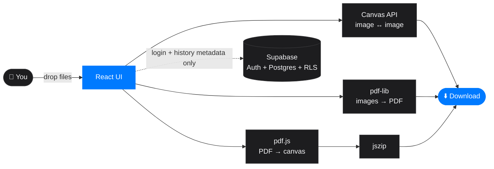

<div align="center">


<br/>

<!-- Swap these two files in /public or /src/assets with your final AR logo exports -->
<picture>
  <source media="(prefers-color-scheme: dark)" srcset="./src/assets/logo-dark.png">
  <source media="(prefers-color-scheme: light)" srcset="./src/assets/logo-light.png">
  
</picture>

<br/><br/>

<a href="https://metamorph.alshanrijal.com.np">
  
</a>

<br/><br/>

<a href="https://metamorph.alshanrijal.com.np"></a>


<br/>


<br/><br/>


<br/><br/>

**[Live Demo](https://metamorph.alshanrijal.com.np)** &nbsp;•&nbsp; **[Features](#-features)** &nbsp;•&nbsp; **[How it works](#-how-it-works)** &nbsp;•&nbsp; **[Quick start](#-quick-start)** &nbsp;•&nbsp; **[Deploy](#-deployment)** &nbsp;•&nbsp; **[Roadmap](#-roadmap)**

</div>

<br/>


## 🪄 About

**Metamorph** is a browser-native file converter. Images and PDFs are converted **on your device**, using the Canvas API, `pdf.js` and `pdf-lib`. Files are never uploaded, there is no conversion server, and nothing is stored remotely.

An optional account (Google or email) unlocks a **synced conversion history**. Only metadata is saved (file name, conversion type, count, timestamp), never the files.

<div align="center">

<table>
<tr>
<td align="center" width="200">
<br/>
<b>Private by design</b><br/>
<sub>Files never leave your browser</sub>
</td>
<td align="center" width="200">
<br/>
<b>Instant</b><br/>
<sub>No upload or download round-trip</sub>
</td>
<td align="center" width="200">
<br/>
<b>Batch ready</b><br/>
<sub>Many pages in, one ZIP out</sub>
</td>
<td align="center" width="200">
<br/>
<b>Light and dark</b><br/>
<sub>Theme persists across visits</sub>
</td>
</tr>
</table>

</div>

<br/>

## ✨ Features

<table>
<tr>
<td width="50%" valign="top">

### 🖼️ Image Converter
Convert between **PNG, JPG, JPEG and WEBP** in any direction. Drop several files, remove one, add more later, and convert the whole batch. A single output downloads directly, and multiple outputs arrive as one ZIP.

### 📄 PDF → Image
- Page count detected on upload
- **Page range selector** (for example pages 6 to 12 of a 30-page PDF), validated against the real page count
- Numbered thumbnails preview exactly which pages will be rendered
- Live progress: *"Converting page 4 of 7…"*
- Download everything as a single ZIP

</td>
<td width="50%" valign="top">

### 🧩 Image → PDF
Combine one or many images into a single PDF, one image per page. WEBP is converted through Canvas first so every format works.

### 🔐 Accounts and History
- Continue with **Google**, or email and password with confirmation
- Avatar shows your Google photo, or your initials for email accounts
- **History** page with Images and PDFs tabs
- **Profile** page with stats, name editing, add or change password

### 🎛️ Polished UX
Real thumbnail previews, drag and drop, a persistent light/dark theme, a sidebar-driven convert workspace, and clear empty states.

</td>
</tr>
</table>

<br/>


## ⚙️ How it works



| Conversion | Engine | Output |
|---|---|---|
| PNG / JPG / JPEG / WEBP ↔ each other | Canvas `toBlob()` | Single file, or ZIP for a batch |
| PDF → PNG / JPG / WEBP | `pdfjs-dist` renders each page to a canvas | ZIP |
| PNG / JPG / WEBP → PDF | `pdf-lib` embeds images, one per page | Single PDF |

> [!NOTE]
> Supabase only handles **authentication and history metadata**. It never receives your files.

<br/>

## 🧱 Tech Stack

<div align="center">


</div>

<br/>

| Layer | Technology |
|---|---|
| UI | React 18 (Vite), Tailwind CSS, React Router |
| Auth and data | Supabase Auth (Google OAuth, email/password), Postgres with Row Level Security |
| PDF rendering | `pdfjs-dist` |
| PDF creation | `pdf-lib` |
| Zipping | `jszip`, `file-saver` |
| Hosting | Cloudflare Pages (static, no backend server) |

<br/>


## 🚀 Quick start

<div align="center">

</div>

**Prerequisites:** Node.js 18+ and a free [Supabase](https://supabase.com) project.

```bash
git clone https://github.com/alshan-rijal/metamorph.git
cd metamorph
npm install
```

Create `.env.local` in the project root:

```env
VITE_SUPABASE_URL=https://YOUR-PROJECT.supabase.co
VITE_SUPABASE_ANON_KEY=your-anon-key
```

```bash
npm run dev        # http://localhost:5173
npm run build      # production build in /dist
npm run preview    # preview the production build
```

<br/>

## 🗄️ Supabase setup

<details>
<summary><b>1. Database table and Row Level Security</b></summary>

<br/>

```sql
create table conversion_history (
  id              uuid primary key default gen_random_uuid(),
  user_id         uuid not null references auth.users on delete cascade,
  file_name       text,
  conversion_type text,
  file_count      int  default 1,
  created_at      timestamptz default now()
);

alter table conversion_history enable row level security;

create policy "Users read own history"
  on conversion_history for select
  using (auth.uid() = user_id);

create policy "Users insert own history"
  on conversion_history for insert
  with check (auth.uid() = user_id);
```

</details>

<details>
<summary><b>2. Authentication providers</b></summary>

<br/>

1. **Authentication → Providers → Google**: enable it and paste your Google Cloud OAuth Client ID and Secret.
2. In Google Cloud Console, add the Supabase callback as an authorized redirect URI:
   `https://YOUR-PROJECT.supabase.co/auth/v1/callback`
3. **Authentication → Settings**: turn **Confirm email** on.
4. Use `redirectTo: window.location.origin` in `signInWithOAuth` so it works in dev and production.

</details>

<details>
<summary><b>3. URL configuration (important for production)</b></summary>

<br/>

Under **Authentication → URL Configuration**:

- **Site URL:** `https://metamorph.alshanrijal.com.np`
- **Redirect URLs** (add each one):

```
https://metamorph.alshanrijal.com.np
https://metamorph.alshanrijal.com.np/**
http://localhost:5173
http://localhost:5173/**
```

> [!WARNING]
> If Google login sends you back to `localhost` after deploying, the Site URL or the Redirect URL allow-list is still pointing at your dev address.

</details>

<details>
<summary><b>4. Keep the free-tier project awake</b></summary>

<br/>

Supabase pauses free projects after about a week of no activity. A scheduled ping prevents it, for example with a GitHub Action:

```yaml
# .github/workflows/keepalive.yml
name: Supabase keep-alive
on:
  schedule:
    - cron: "0 6 */3 * *"   # every 3 days
  workflow_dispatch:
jobs:
  ping:
    runs-on: ubuntu-latest
    steps:
      - run: |
          curl -s -o /dev/null -w "%{http_code}\n" \
            "${{ secrets.SUPABASE_URL }}/rest/v1/conversion_history?select=id&limit=1" \
            -H "apikey: ${{ secrets.SUPABASE_ANON_KEY }}"
```

</details>

<br/>


## ☁️ Deployment

Metamorph is a pure static build, so any static host works. On **Cloudflare Pages**:

| Setting | Value |
|---|---|
| Framework preset | Vite |
| Build command | `npm run build` |
| Build output directory | `dist` |
| Environment variables | `VITE_SUPABASE_URL`, `VITE_SUPABASE_ANON_KEY` |
| Custom domain | `metamorph.alshanrijal.com.np` |

For client-side routing, add a `public/_redirects` file so deep links like `/history` don't 404:

```
/*  /index.html  200
```

<br/>

## 📁 Project structure

<details>
<summary><b>Expand file tree</b></summary>

```
metamorph/
├── public/
│   ├── _redirects
│   └── favicon.svg
├── src/
│   ├── assets/               # logo-light.png, logo-dark.png, hero art
│   ├── lib/
│   │   ├── supabaseClient.js
│   │   ├── imageConvert.js   # Canvas-based format conversion
│   │   ├── pdfToImages.js    # pdf.js render + page range + zip
│   │   ├── imageToPdf.js     # pdf-lib embedding
│   │   └── downloadHelpers.js
│   ├── context/
│   │   ├── AuthContext.jsx   # session, user, avatar/initials logic
│   │   └── ThemeContext.jsx  # persisted light/dark theme
│   ├── components/
│   │   ├── layout/           # Header, nav dropdown, footer
│   │   ├── auth/             # split-panel login / signup modal
│   │   ├── convert/          # upload zone, file cards, range selector, progress
│   │   ├── history/          # tabs and cards
│   │   └── ui/               # buttons, avatar
│   ├── pages/                # Home, Convert, About, History, Profile
│   ├── App.jsx
│   └── main.jsx
├── .env.local
├── tailwind.config.js
└── package.json
```

</details>

<br/>

## 🎨 Design system

<div align="center">

| | Token | Hex |
|---|---|---|
|  | Light background | `#F5F5F7` |
|  | Dark background | `#1D1D1F` |
|  | Muted text | `#AAAAAA` |
|  | Accent | `#007AFF` |

</div>

Soft shadows instead of hard borders, 16 to 24px rounded cards, one accent colour used consistently, and full light and dark support.

<br/>


## 🔒 Privacy

> **Your files never leave your device.** All conversions run in your browser. If you sign in, Metamorph stores your email, display name, and a log of *what* you converted (type, count, time). It never stores the files themselves.

<br/>

## 🛣️ Roadmap

- [x] Image ↔ Image (PNG, JPG, JPEG, WEBP)
- [x] PDF → Image with page range and ZIP export
- [x] Image → PDF
- [x] Google and email authentication with confirmation
- [x] Conversion history and profile
- [x] Light and dark theme with persistence
- [ ] Re-download from history (optional output storage)
- [ ] Drag to reorder pages for Image → PDF
- [ ] Quality and resolution controls
- [ ] Installable PWA with offline support
- [ ] DOCX ↔ PDF (needs a server-side engine)

<br/>

## 🤝 Contributing

Issues and pull requests are welcome.

1. Fork the repo
2. Create a branch: `git checkout -b feature/your-idea`
3. Commit: `git commit -m "Add your idea"`
4. Push and open a Pull Request

<br/>

## 📬 Contact

<div align="center">

<a href="https://alshanrijal.com.np"></a>
<a href="mailto:contact@alshanrijal.com.np"></a>
<a href="https://github.com/alshan-rijal"></a>
<a href="https://instagram.com/alshan_rijal_"></a>

</div>

<br/>

## 📄 License

Released under the [MIT License](LICENSE).

<br/>


<div align="center">
<sub>Built with 🖤 and 💙 by <a href="https://alshanrijal.com.np">Alshan Rijal</a></sub>
</div>
